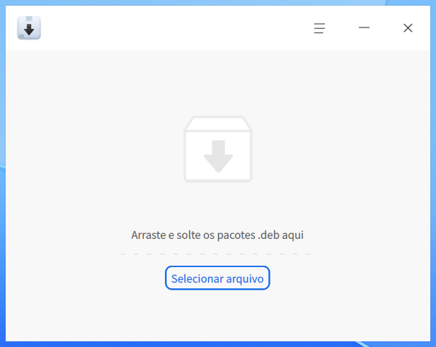
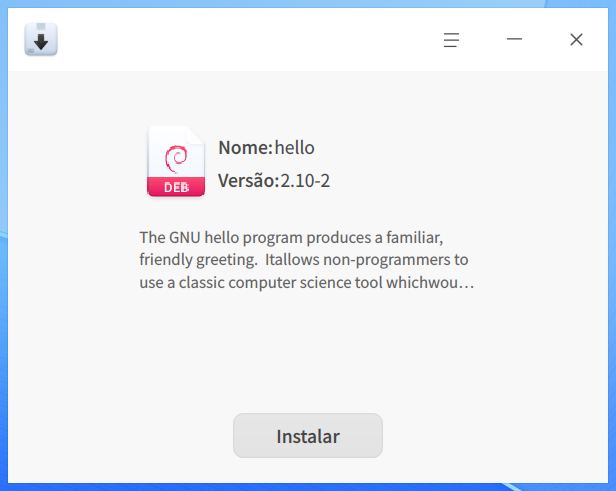
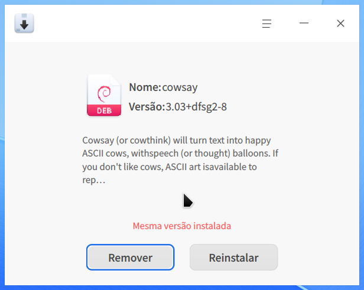
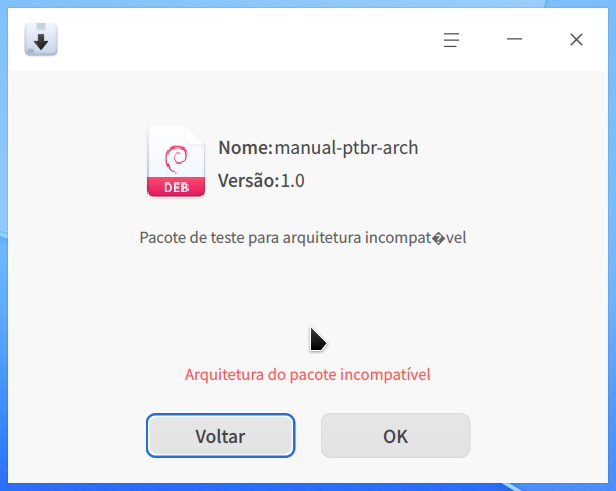
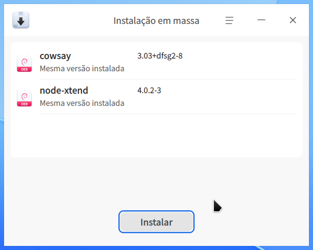
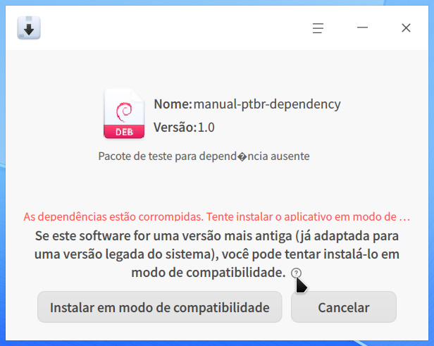
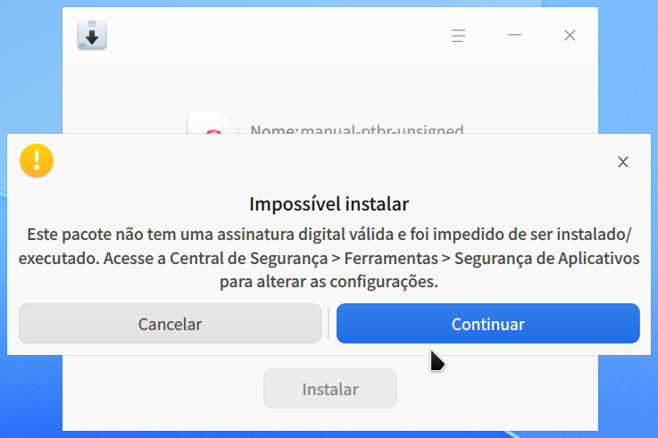
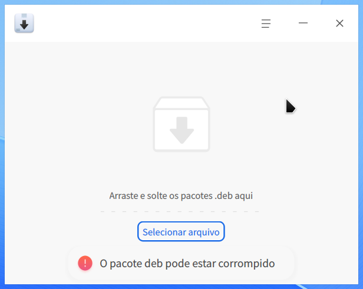
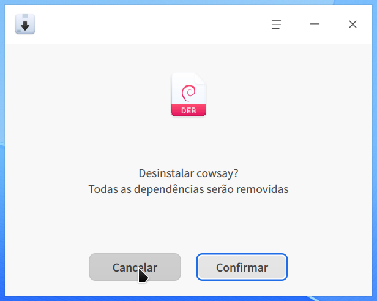

# Instalador de Pacotes|deepin-deb-installer|

## Visão geral

O Instalador de Pacotes permite instalar e remover pacotes locais e também oferece instalação em massa, identificação de versões e verificação de dependências.

## Operações

### Abrir o Instalador de Pacotes

Você pode abrir o Instalador de Pacotes pelo Inicializador, clicar duas vezes em um pacote compatível no Gerenciador de Arquivos ou arrastar o pacote para a janela do aplicativo.

### Instalar um pacote

1. Clique em **Selecionar arquivo**, escolha o pacote e clique em **Abrir**.
2. Confira o nome, a versão e as informações exibidas.
3. Clique em **Instalar** e conclua a autenticação solicitada pelo sistema.
4. Aguarde a conclusão da instalação. Para confirmar o resultado, selecione novamente o mesmo pacote.
5. Quando **Mesma versão instalada** for exibido, o pacote já estará instalado. Você poderá removê-lo ou reinstalá-lo.

### Pacote incompatível com a arquitetura

Se a arquitetura do pacote não for compatível com o computador, o Instalador de Pacotes bloqueará a instalação. Clique em **Voltar** para escolher outro arquivo ou em **OK** para fechar o aviso.

### Instalar vários pacotes

Selecione ou arraste vários pacotes para a janela. Antes de iniciar, confira o nome, a versão e o estado de cada item da lista. Clique em **Instalar** somente depois de confirmar todos os pacotes.

### Quando não for possível instalar

O Instalador de Pacotes verifica o arquivo antes da instalação. Entre as causas possíveis estão arquitetura incompatível, dependências ausentes ou corrompidas, assinatura digital inválida e arquivo danificado.

Se houver um problema de dependência, leia a mensagem exibida. Para alguns pacotes antigos, o aplicativo poderá oferecer a instalação em modo de compatibilidade. Use essa opção somente com pacotes confiáveis destinados a uma versão anterior do sistema.

Quando a política de segurança exigir uma assinatura digital válida, pacotes sem assinatura serão bloqueados. Clique em **Cancelar** para interromper. Altere a configuração em **Central de Segurança** somente se você confiar na origem do pacote.

Se o arquivo estiver incompleto ou danificado, o aplicativo informará que o pacote pode estar corrompido. Obtenha uma nova cópia de uma fonte confiável antes de tentar novamente.

### Remover um pacote

1. Abra o pacote correspondente ao aplicativo instalado.
2. Clique em **Remover**.
3. Leia a confirmação e clique em **Confirmar**.
4. Conclua a autenticação solicitada pelo sistema.
5. Aguarde a remoção.

## Menu principal

Clique no botão de menu no canto superior direito para acessar as opções a seguir.

### Configurações

Clique em **Configurações** para consultar o caminho da política de aplicativos sem assinatura. Para revisar essa política, abra **Central de Segurança > Ferramentas > Segurança de Aplicativos**.

### Tema

Clique em **Tema** e escolha **Claro**, **Escuro** ou **Padrão**.

### Ajuda

Clique em **Ajuda** para abrir o manual do aplicativo.

### Sobre

Clique em **Sobre** para consultar a versão, a página web e a descrição do Instalador de Pacotes.

### Sair

Clique em **Sair** para fechar o aplicativo.
